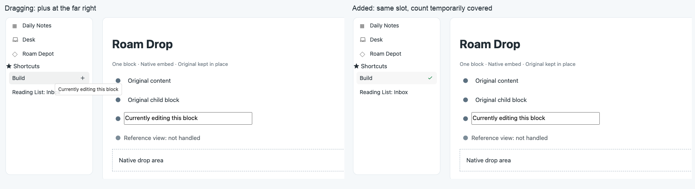

# Roam Drop

Drag a block onto **Daily Notes**, **Desk**, or a **starred page** in Roam's left sidebar to add a live embed. The original stays in place.

In-memory sandbox demonstration; this image does not show a production graph.

## Use

1. Grab a block's bullet in the main outline or right sidebar. This also works while its editor has a cursor.
2. Drag onto a supported sidebar row, without modifier keys. A **+** marks the destination.
3. Release to collect the block. A brief **green check** means a new entry was added; click the page normally to view it.

A neutral circled check explains when no new entry is needed: **Already in today's note**, **Already on this page**, or **Already added**. A warning is reserved for a blocked or unconfirmed operation and immediately shows its reason. [Feedback examples](assets/outcome-feedback-sandbox.png).

The plus and check share a fixed slot at the far right. Reference counts are covered while feedback is visible and reappear afterward.

**Daily Notes** collects into today's daily note page, even when you're viewing another day. **Desk** uses your native Desk binding; open Desk once to initialize it. **Starred pages** collect into the linked page.

Entries appear at the top. Repeated drops onto the same destination don't add duplicates. The same block can be collected into different pages. There is no inline Undo action; entries remain ordinary Roam blocks.

## Scope

One block at a time, within the same graph and window. Drag by the bullet; dragging editor text keeps its normal behavior. Modifier gestures and other drop targets retain their native behavior. Whole pages, multi-block selections, external drops, and reference/query/embed views aren't supported. Functional sidebar items such as Roam Depot aren't drop destinations.

The extension creates `{{embed-path: ((uid)) closed}}` entries and never moves, updates, or deletes the source block. Dropping a block onto its own page leaves it as-is and shows an informational result.

[Draft Depot PR #1511](https://github.com/Roam-Research/roam-depot/pull/1511) · PR preview: `404KSG+roam-desk-drop+1511`.

[Technical details](docs/design.md) · [Interaction](docs/quiet-interaction.md) · [Verification and remaining gaps](docs/verification.md) · [MIT license](LICENSE)

Earlier demo assets show the Desk-only interaction from 0.1.3. Third-party demo content retains its owners' rights.
