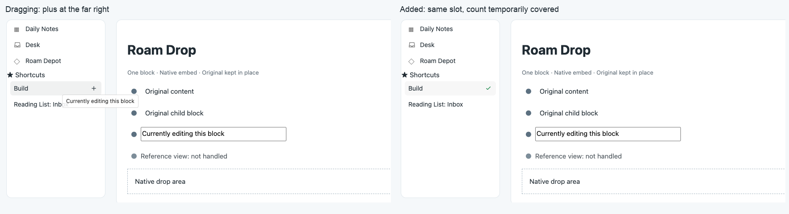

# Roam Drop

Drag a block to **Daily Notes, Desk, or a starred page in the left sidebar** to collect it as a live embed at the top of that page. The original block, its children, and its outline position stay unchanged.

Use it to gather meeting actions, reading excerpts, or project notes without reorganizing the source pages.

*0.2.2 sandbox demo, not a production graph.*

## How to use

1. Make the left sidebar visible. Grab **one block's bullet** in the main or right-sidebar outline, even while editing.
2. Drag onto a supported sidebar row **without modifier keys**. Release when its plus appears.
3. A **green check** means added; a **neutral check** means existing content; a **warning** explains a problem. Open the destination normally to view the embed.

Native text selection, outline reordering, and sidebar navigation stay unchanged.

## Destinations

- **Daily Notes:** today's page at drop time; created if missing.
- **Desk:** your native Desk page. Open it once first to initialize it.
- **Starred page:** an existing page in this graph, not a block shortcut.

## Keep in mind

- Same-page sources and matching **top-level embeds** are skipped. This is not graph-wide deduplication.
- One block, one graph, one window. Whole pages, multi-block selections, external content, touch dragging, and reference/query/embed views are unsupported.
- No inline Undo. If a write cannot be confirmed, inspect the destination before retrying. Disabling the extension keeps existing entries.
- No analytics, external network requests, or clipboard access. Roam's normal access rules still apply.

[Technical details](https://github.com/404KSG/roam-desk-drop/blob/bc05b28998e421a4711952a79a0994a98807693b/docs/design.md) · [Interaction guide](https://github.com/404KSG/roam-desk-drop/blob/bc05b28998e421a4711952a79a0994a98807693b/docs/quiet-interaction.md) · [Verification and limits](https://github.com/404KSG/roam-desk-drop/blob/bc05b28998e421a4711952a79a0994a98807693b/docs/verification.md) · [MIT](LICENSE)

Third-party demo content retains its owners' rights.
